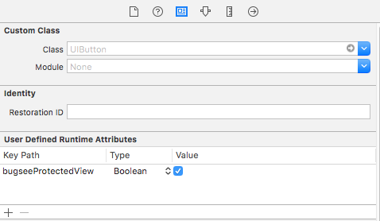

import Tabs from '@theme/Tabs';
import TabItem from '@theme/TabItem';

:::note
Looking for the previous SDK? See the [6.x video privacy page](/sdk/ios/v6/privacy/video).
:::

Bugsee records the screen as video, attaches a screenshot to the report, and records touches
and gestures. Everything on this page applies to all three: an area hidden from the video is
also blanked in the report screenshot, and touches inside it are dropped from the report.

## Disabling video

Set `BugseeOptionCaptureVideo` (`BugseeOptions.videoEnabled`) to `NO` to record no video and no
touches. The report screenshot is controlled separately: turn it off with
`BugseeOptionCaptureScreenshot` (`BugseeOptions.screenshotEnabled`). See
[Configuration](/sdk/ios/configuration).

<Tabs groupId="lang-ios">
  <TabItem value="objective-c" label="Objective-C">

```objectivec
BugseeOptions *options = [BugseeOptions defaultOptions];
options.videoEnabled = NO;
options.screenshotEnabled = NO;

[Bugsee launchWithToken:@"<your_app_token>" options:options];
```

  </TabItem>
  <TabItem value="swift" label="Swift">

```swift
let options = BugseeOptions.default()
options.videoEnabled = false
options.screenshotEnabled = false

Bugsee.launch(token: "<your_app_token>", options: options)
```

  </TabItem>
</Tabs>

## What is hidden automatically

- **Secure text fields.** A `UITextField` or `UITextView` with `secureTextEntry` set is masked
  in the video. This includes SwiftUI's `SecureField`.
- **The keyboard, while a masked field has focus.** While a secure or protected text field or
  text view is the first responder, the keyboard is left out of the video and no touches are
  recorded.
- **Typing.** Touches on a `UITextField` or `UITextView`, and key presses into one, are never
  recorded.
- **Payment card fields.** The card number, CVC and expiry fields of Stripe, Braintree and
  card.io are marked protected when the SDK starts, so they are masked like any protected view.
- **WebView password and card fields.** See [WebView elements](#webview-elements).
- **Text in the view hierarchy.** The view hierarchy attached to a report never contains the
  text of labels or fields.

## Protecting views

Mark any other view as protected, and its area is blacked out in the video and the screenshot.
Touches that start on it are dropped from the report.

<Tabs groupId="lang-ios">
  <TabItem value="objective-c" label="Objective-C">

```objectivec
@import Bugsee;

[Bugsee addSecureView:self.balanceLabel];

// ...and when it no longer needs hiding
[Bugsee removeSecureView:self.balanceLabel];
```

  </TabItem>
  <TabItem value="swift" label="Swift">

```swift
import Bugsee

Bugsee.addSecureView(balanceLabel)

// ...and when it no longer needs hiding
Bugsee.removeSecureView(balanceLabel)
```

  </TabItem>
</Tabs>

The `bugseeProtectedView` property that the SDK adds to `UIView` has the same effect:

<Tabs groupId="lang-ios">
  <TabItem value="objective-c" label="Objective-C">

```objectivec
self.balanceLabel.bugseeProtectedView = YES;
```

  </TabItem>
  <TabItem value="swift" label="Swift">

```swift
balanceLabel.bugseeProtectedView = true
```

  </TabItem>
</Tabs>

A protected view hides everything inside its bounds, the views it contains included, and in the
view hierarchy it and the views it contains are flagged as protected.

### In a storyboard or xib



1. Open the storyboard or xib file and select the view to protect.
2. Open the Identity inspector.
3. Add a User Defined Runtime Attribute named `bugseeProtectedView`, of type Boolean, checked.

### In SwiftUI

The `BugseeSwiftUI` module adds the `bugseeProtect()` and `bugseeProtect(isEnabled:)` view
modifiers:

```swift
import BugseeSwiftUI

Text(account.balance)
    .bugseeProtect()
```

See [SwiftUI](/sdk/ios/swiftui) for setup and the dynamic form.

### While protected views move

During an animated transition, such as a view controller push, the masks of protected views
cannot follow every frame. By default those frames are recorded blurred into unreadable blocks.
Set `BugseeOptionCaptureVideoPrivacyBlur` to `NO` to skip them instead: the video then freezes
for the length of the transition. Either way the transition is never recorded unprotected in the
video. The report screenshot is not blurred this way: a screenshot taken during a transition can
show a protected view before its mask has caught up.

## Secure rectangles

Hide a part of the screen by its coordinates.

<Tabs groupId="lang-ios">
  <TabItem value="objective-c" label="Objective-C">

```objectivec
// Returns NO if the rectangle is already hidden
BOOL added = [Bugsee addSecureRectangle:CGRectMake(10, 10, 100, 100)];

// Returns NO if there is no such rectangle
BOOL removed = [Bugsee removeSecureRectangle:CGRectMake(10, 10, 100, 100)];

[Bugsee removeAllSecureRectangles];
```

  </TabItem>
  <TabItem value="swift" label="Swift">

```swift
// Returns false if the rectangle is already hidden
let added = Bugsee.addSecureRectangle(CGRect(x: 10, y: 10, width: 100, height: 100))

// Returns false if there is no such rectangle
let removed = Bugsee.removeSecureRectangle(CGRect(x: 10, y: 10, width: 100, height: 100))

Bugsee.removeAllSecureRectangles()
```

  </TabItem>
</Tabs>

:::warning
Do not read the values that `getAllSecureRectangles` returns with `CGRectValue` (`cgRectValue`).
In 7.0.0 they do not hold a `CGRect`, and the call raises an exception. Keep your own list of
the rectangles you add.
:::

- Coordinates are in points, in the screen's coordinate space (`UIScreen.coordinateSpace`), with
  the origin in the top-left corner. They follow the interface orientation: when the interface
  rotates, the same rectangle covers a different part of your content, so update your
  rectangles when the layout changes.
- With several of the app's windows on the screen (iPad Split View or Stage Manager), every
  window is recorded. Convert a rectangle measured in a window to screen coordinates before you
  add it:

  ```swift
  let rect = view.convert(view.bounds, to: view.window!.screen.coordinateSpace)
  Bugsee.addSecureRectangle(rect)
  ```

- Touches that start inside a rectangle are dropped from the report.

## WebView elements

In a `WKWebView`, mark a page element with the `bugsee-hide` CSS class to hide it:

```html
<input type="text" class="bugsee-hide">
<div class="bugsee-hide">Account number: 1234 5678</div>
```

Password inputs (`type="password"`) and inputs whose `autocomplete` attribute names a card field
(`cc-number`, `cc-csc`, and other `cc-` values) are hidden without the class. To record one of
them anyway, add the `bugsee-show` class:

```html
<input type="password" class="bugsee-show">
```

This works through a script Bugsee adds to the page, which is controlled by
`BugseeOptionCaptureWebViewAdvanced` (on by default). With the option off, no script is added
and these elements are not hidden: protect the whole web view instead. Bugsee attaches itself to
web views automatically; for a `WKWebView` created before `launchWithToken:`, call
`addSecureWebView:`:

<Tabs groupId="lang-ios">
  <TabItem value="objective-c" label="Objective-C">

```objectivec
[Bugsee addSecureWebView:self.webView];
```

  </TabItem>
  <TabItem value="swift" label="Swift">

```swift
Bugsee.addSecureWebView(webView)
```

  </TabItem>
</Tabs>

`addSecureWebView:` does not hide the web view. To hide all of it, protect it as a view with
`addSecureView:`.

## Blackout

Blackout suppresses every capture that describes the screen, for as long as you need:

- the video, which records a black placeholder frame;
- the report screenshot;
- touches and gestures;
- the keyboard and focus breadcrumbs;
- the view hierarchy.

Console logs, network events, traces and other non-visual data keep being captured.

<Tabs groupId="lang-ios">
  <TabItem value="objective-c" label="Objective-C">

```objectivec
[Bugsee startBlackout];
// ... sensitive flow ...
[Bugsee endBlackout];

BOOL blackedOut = [Bugsee isBlackout];
```

  </TabItem>
  <TabItem value="swift" label="Swift">

```swift
Bugsee.startBlackout()
// ... sensitive flow ...
Bugsee.endBlackout()

let blackedOut = Bugsee.isBlackout()
```

  </TabItem>
</Tabs>

- A blackout lasts until `endBlackout` or `stop:`. Stopping ends it, and a later launch starts
  without one: call `startBlackout` again to black out the new session. A `stop:` made while
  Bugsee is not running, before the launch that a blackout was started for, leaves that blackout
  on.
- A relaunch is the exception: it keeps the blackout, so the new session starts blacked out.
- `startBlackout` called before launch is honoured: the session starts blacked out.
- The transitions are reported as the `BugseeLifecycleEventBlackoutStarted` and
  `BugseeLifecycleEventBlackoutEnded` lifecycle events. See
  [Lifecycle & status](/sdk/ios/lifecycle).

## Recording less detail

When too many views hold sensitive data to mark them one by one, record them at a detail too low
to read. You can still follow the user's navigation.

| Option | Default | Effect |
| --- | --- | --- |
| `BugseeOptionCaptureVideoScale` (`videoScale`) | `1.0` | Reduces the detail of every recorded video frame. A value between 0 and 1 enables it, for example `0.3`; `0` and values of 1 or more leave it off. |
| `BugseeOptionCaptureScreenshotScale` | `1.0` | The same for the report screenshot. A value below 1 reduces its detail. Unlike the video scale, `0` or less does not turn it off: it gives the strongest reduction. |

## Video from players and the camera

Some content is not drawn by your views, and Bugsee records it only when you opt in:

| Option | Default | Records |
| --- | --- | --- |
| `BugseeOptionCaptureAVPlayer` (`captureAVPlayer`) | `NO` | Video played through `AVPlayerLayer` and `AVPlayerViewController`. |
| `BugseeOptionCaptureSampleBufferDisplayLayer` (`captureSampleBufferDisplayLayer`) | `NO` | Video the app renders into an `AVSampleBufferDisplayLayer`, as used by video-calling and custom players. |
| `BugseeOptionCaptureCameraPreview` (`captureCameraPreview`) | `NO` | The live camera image in an `AVCaptureVideoPreviewLayer`. |

:::warning[Camera preview records what the camera sees]
With `BugseeOptionCaptureCameraPreview` on, bug reports contain whatever the lens is pointed at —
faces, surroundings, documents — whether or not the user ever took a photo. Do not enable it
unless your users know and agree. It also makes Bugsee part of your capture session: it reads
frames from your `AVCaptureVideoDataOutput`, or adds an output of its own, and a camera screen
then records at the full frame rate. Without the option, a camera preview records as an empty
rectangle.
:::

## Checking what is recorded

`showVideoCapturePreview` shows a floating panel with a live preview of the frames Bugsee
captures, masks included. Use it during development to check that your sensitive views are
hidden. The panel itself is not recorded.

<Tabs groupId="lang-ios">
  <TabItem value="objective-c" label="Objective-C">

```objectivec
[Bugsee showVideoCapturePreview];
// ...
[Bugsee hideVideoCapturePreview];
```

  </TabItem>
  <TabItem value="swift" label="Swift">

```swift
Bugsee.showVideoCapturePreview()
// ...
Bugsee.hideVideoCapturePreview()
```

  </TabItem>
</Tabs>
