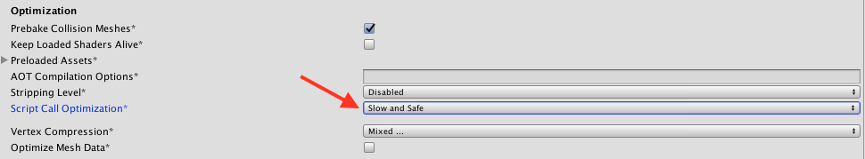
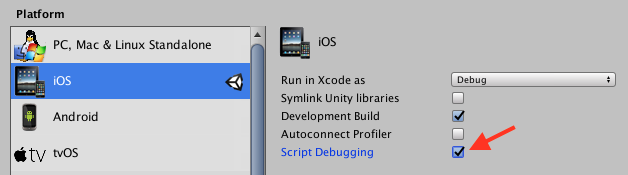

## Managed C# code crashes

In order for Bugsee to be able to receive unhandled exceptions from managed C# code, the **Script Call Optimization** must be set to **Slow and Safe**.
Otherwise unhandled exceptions will result in app crashes with no useful information.

The setting can be found in Player Settings -> Other Settings -> Optimization:


Information about filenames and line numbers is available when **Script Debugging** is enabled as well:


A Unity **Mono Release** build ships no pdb, so managed frames look like
`at Ns.Class.Method (args) [0x0000b] in:0` — a method, an IL offset, and a
module id, with no file or line. With [Bugsee CLI](/cli/) **0.9.0** or newer,
upload the compiler's assemblies and their portable `.pdb` files so the server can
resolve those frames to `File.cs:42`:

```bash
# stripping Disabled: the shipped dll is the compiler's
bugsee-cli debug-files upload Library/Bee/artifacts/1300b0aP.dag \
    --type portable-pdb --version 1.2.3 --build 45

# stripping Low or higher: pass the rewritten assemblies
bugsee-cli debug-files upload Library/Bee/artifacts/1300b0aP.dag \
    --type portable-pdb --version 1.2.3 --build 45 \
    --shipped-dir Library/Bee/artifacts/Android/ManagedStripped
```

A pdb that does not belong to its assembly exits `11` and uploads nothing.
Development builds ship their `.pdb` files and need nothing, unless those files
were stripped afterwards. See [Unity Mono](/cli/debug-files/#unity-mono).

## Native crashes

Unity does not by default enable dSYM creation for its builds. Bugsee does not modify the build to enable it, it has to be done manually
on the resulting Xcode project. It will not work, however, if **Script Debugging** is enabled, dSYM generation fails in this case.

See iOS crash reporting [instructions](/sdk/ios/symbolication/) for information on setting dSYM auto uploading.

